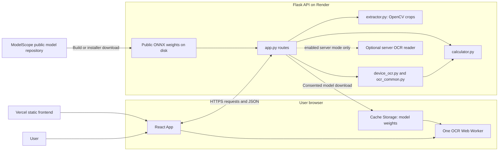
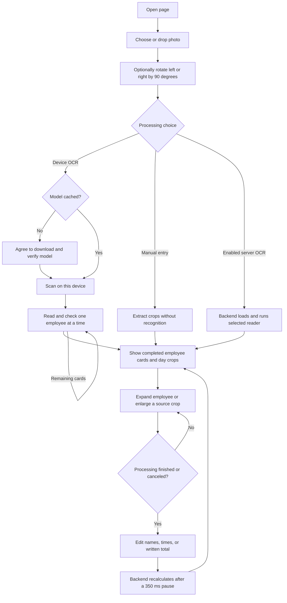
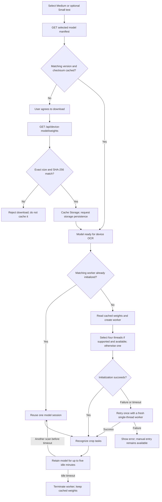
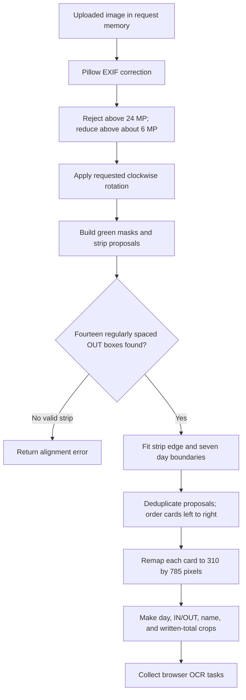
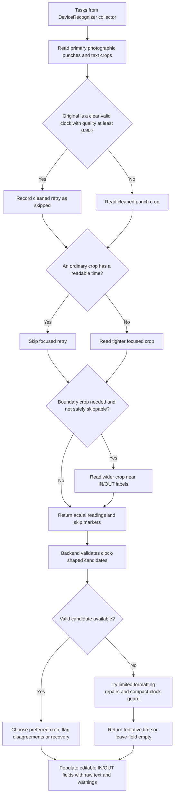
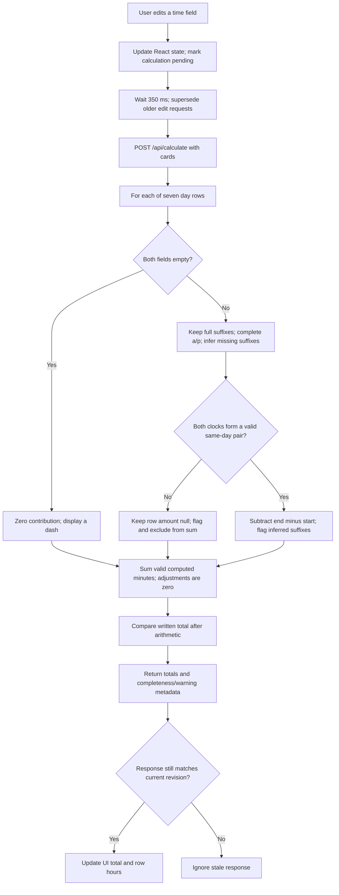
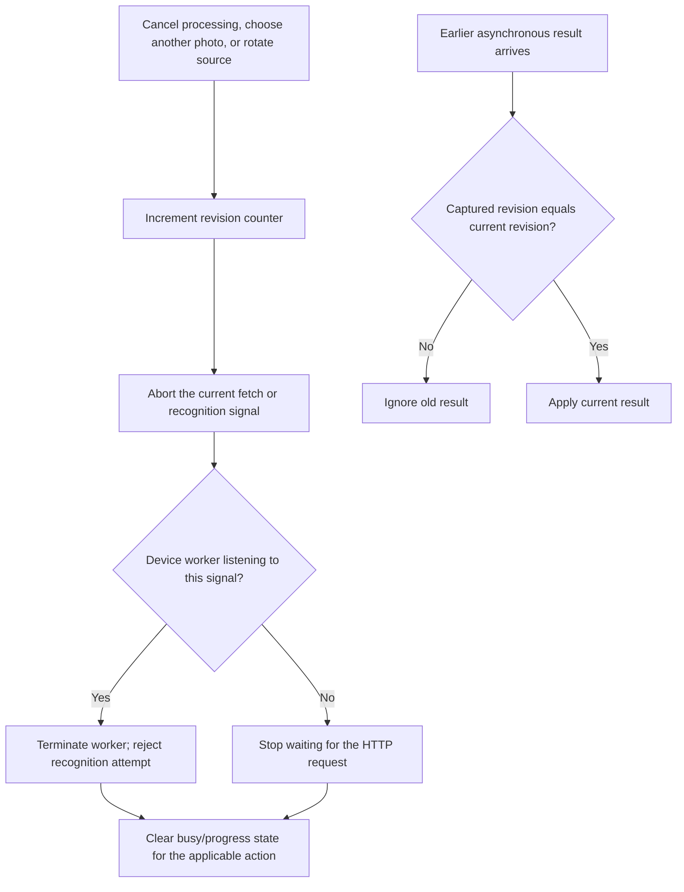

# How Timecard Scanner works

These diagrams describe the current implementation. Paths are relative to the repository root. See the [README](../README.md) for setup, configuration, API payloads, and calculation details.

## 1. Overall architecture

The default deployment serves the UI from Vercel and the API from Render. Recognition runs in the browser; geometry and calculation run in Python. There is **no database**. For local use, Flask can also serve the built UI.



**Source:** `frontend/src/main.tsx`, `api.ts`, `device-ocr.ts`, `ocr.worker.ts`; `backend/app.py`; `Dockerfile`; `frontend/vercel.json`.

React memory contains the current file, preview, cards, and edits. Model weights are cached in the browser; a separate localStorage boolean remembers the Debug statistics preference. Flask processes uploaded images in memory. Optional server OCR is not an automatic fallback for browser failures.

## 2. User application flow

Manual entry still needs a recognizable card grid, but does not require downloaded recognition weights. The server-mode choice appears only when its frontend flag is enabled; the backend must separately permit it.



**Source:** `App()`, `accept()`, `rotateSource()`, `installModel()`, `scan()`, `editDay()`, `editCard()`, and `update()` in `frontend/src/main.tsx`.

The first available employee is expanded by default. Completed cards stay viewable while the remaining cards run; editing is locked until processing stops. A failed results request does not cancel OCR. Temporary failures retry up to three attempts; a continuing connection failure pauses result submissions while remaining OCR readings are kept in page memory. **Retry unfinished cards** resumes those results without recognition or another upload. Refreshing, a new scan, or a new photo clears those saved readings. Canceling keeps completed cards and rejects late results. Status, adjustment, note, and reviewed fields still exist internally, but their controls are absent from the current UI. Clear both time fields to exclude a day.

## 3. Request and data flow: default device OCR

The backend does not keep a scan object between requests. The browser sends normalized layouts back with OCR readings so the next request can rebuild the crops without a saved upload.

```mermaid
sequenceDiagram
    actor User
    participant UI as React App
    participant API as Flask routes
    participant Geometry as extractor.py
    participant Worker as OCR worker
    participant Calc as Python parsing and calculation

    User->>UI: Choose photo and rotation; start scan
    UI->>API: POST /api/scan: image, rotation, device=true, live=true
    API->>Geometry: EXIF correction, resizing, rotation, detect_cards()
    Geometry-->>API: Normalized cards and crop geometry
    API->>Calc: extract() with collecting DeviceRecognizer
    Calc-->>API: Deterministic crop tasks
    API-->>UI: layouts + tasks + per-card task IDs
    UI->>Worker: Tasks, card groups, vocabulary, cached model if needed
    loop Each employee card
        Worker-->>UI: Completed card readings; continue OCR on next card
        UI->>API: POST /api/device-result: one layout + its readings
        API->>Calc: Rebuild card, parse punches, calculate totals
        Calc-->>API: One parsed card and computed totals
        alt Result succeeds
            API-->>UI: Completed card
            UI-->>User: View card and source crops; edits locked
        else Busy or network failure
            UI->>API: Retry with backoff when appropriate
            Note over UI: If still unavailable, retain readings; OCR continues
        end
    end
    Worker-->>UI: All readings and timing statistics
    UI-->>User: Unlock editing after queued results finish
    User->>UI: Correct a time
    Note over UI: Update locally; wait 350 ms after latest edit
    UI->>API: POST /api/calculate: full cards array
    API->>Calc: Validate and calculate_cards(punch_only=True)
    Calc-->>API: Recomputed cards
    API-->>UI: cards
    UI-->>User: Updated day hours and employee total
```

**Source:** `scan()`/`update()` in `main.tsx`; `/api/scan`, `/api/device-result`, `/api/calculate` in `backend/app.py`; `DeviceRecognizer`, `pack_layouts()`, `unpack_layouts()` in `backend/device_ocr.py`.

The original photo is uploaded once per scan. Initial cropping still prepares all cards before OCR starts. `ocr-batches.ts` orders each card's work and shared prerequisites without reading duplicate tasks again. `live-results.ts` queues result requests one at a time and retains unfinished jobs; `request-json.ts` retries temporary failures with backoff, cancellation, and a timeout. Successful cards retain their totals when other requests fail. Manual result retries insert only the recovered cards, preserving edits to existing cards. Older preparation responses without card groups still use one full-batch result request. Recalculation currently serializes the entire cards array, including its image fields. There is no database request and no server-side lookup by `scan_id`.

## 4. Core feature: model download and worker lifecycle

Cached weights and an already initialized model are different things. Refreshing can keep the former while losing the latter.



**Source:** `modelPresent()`, `downloadModel()`, `recognizeAttempt()`, `recognizeOnDevice()`, `releaseDeviceModel()` in `frontend/src/device-ocr.ts`; `ocrThreadCount()` in `ocr-threads.ts`; session initialization in `ocr.worker.ts`.

The diagram shows the default thread setting. `VITE_OCR_THREADS` can explicitly request one, two, or four; a request exceeding reported cores uses one. Missing isolation/shared memory also selects one. The initialization watchdog is 30 seconds per attempt. Medium is the default; Small uses `?variant=small` on the manifest and weight endpoints. Models have separate cache keys. Switching models terminates the worker; removing a selected model deletes only its cached weights. Page exit and cancellation terminate the worker without deleting verified cached weights.

## 5. Core feature: finding the seven-day card grid

The default path locates printed green geometry before any handwriting recognition. It is specific to the expected card layout, not a general document-table detector.



**Source:** the `/api/scan` preprocessing in `backend/app.py`; `bar_geometry()`, `detect_cards()`, `clean_ink()`, and `punch_bands()` in `backend/extractor.py`.

Normal punch cells start at normalized x=198. The label-edge retry starts at x=190 when boundary ink is detected. The displayed day crop starts at x=182 so the user can inspect handwriting beside the printed labels. App scans skip note recognition and do not encode separate note/punch previews; full-card and day images remain available.

## 6. Core feature: crop retries and messy text parsing

The worker processes tasks in stages across the scan. This diagram summarizes the decisions; shared/deduplicated tasks must satisfy every dependent field before being skipped.



**Source:** `cropStage()`, `skipFallback()`, `clearClock()`, `readableClock()` in `frontend/src/ocr-policy.ts`; inference in `ocr.worker.ts`; `DeviceRecognizer.read_punches()`; `choose_reading()` in `backend/rapid_recognizer.py`; `clock_text()` and `tentative_clock_text()` in `backend/ocr_common.py`.

A label-edge retry also runs for potentially clipped leading hours 0, 1, or 2 even if the ordinary result looks valid. Backend selection only replaces an established time under the specific leading-1 restoration rule with matching minutes/compatible meridiem, or when ordinary parsing fails. Other disagreements remain warnings. A low score alone does not prohibit filling a valid time.

For example, strict normalization can turn `I0 : 5S p.m.` into `10:55pm`. A compact `1125PM` may become tentative `11:25pm`. An invalid clipped `0:55pm` needs a better image reading, rather than an invented leading digit.

## 7. Core feature: editing times and calculating totals

All app routes explicitly request punch-only arithmetic. A status retained in the OCR payload cannot exclude a newly entered valid pair. Legacy calculator callers that omit that option behave differently, as explained in the README.



**Source:** `editDay()`/`update()` in `frontend/src/main.tsx`; `/api/calculate` and `validate_cards()` in `backend/app.py`; `parse_time()`, `calculate_day()`, `calculate_card()`, `format_minutes()`, and `written_total_candidates()` in `backend/calculator.py`.

An incomplete/invalid row does not block the sum of other valid rows; `totals.complete` remains false. `backend/time_inference.py` owns the editable suffix policy; `backend/clock.py` contains strict clock parsing. Complete suffixes are preserved; same-day conflicts are excluded rather than wrapped overnight. A small field hint identifies assumed/recovered suffixes. Editing a field clears its prior annotation; recalculation ignores stale raw OCR suffixes. See [policy configuration](TIME_INFERENCE.md). Disabling inference restores legacy arithmetic; standalone calculator callers omit the policy by default. A completely empty card totals zero. Written totals never change computed minutes. There are no implemented break deductions or overtime rules.

## 8. Core feature: cancellation and stale-result protection

Cancellation stops the browser's active work and prevents its results from being applied. It is not a server job-cancellation endpoint.



**Source:** `revision`, `abort`, `timer`, `cancelScan()`, `accept()`, `rotateSource()`, `scan()`, and `update()` in `main.tsx`; abort handlers in `device-ocr.ts`.

New scans and edits also supersede earlier operations. OpenCV processing already executing in Flask may continue until it finishes, even after the client aborts. There is no persisted job, server-side queue, polling route, or database state to cancel.
